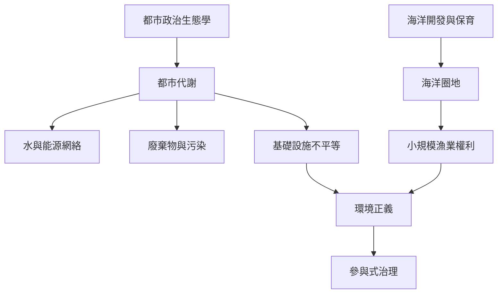

城市與海岸不是孤立的自然空間，而是透過水、能源、材料、食物、港口、污水與廢棄物流動連結遠方土地及勞動。都市政治生態學與海洋圈地研究能把日常服務、全球物流與地方使用權放在同一個視野。

## 參考
* [[城市水與基礎設施是權力關係所組成的都市代謝]]
* [[海洋圈地使小規模漁民失去對海域的使用與治理權]]
* [[經濟成長的環境成本常透過不平等交換跨境轉移]]
* [[都市代謝]]、[[都市政治生態學]]、[[生態不平等交換]]、[[環境正義]]
