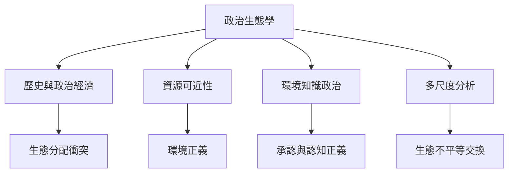

政治生態學以人與環境關係為研究對象，但不把自然與社會看作互不相干的兩個領域。它追問環境變遷如何在歷史、制度、資源權利與跨尺度政治經濟中生成。研究者可由土地退化、資源可近性、知識政治、脆弱性和不平等交換等概念建立分析工具。

## 參考
* [[政治生態學應把環境變遷放回權力與歷史脈絡中理解]]
* [[土地退化不能脫離土地使用者的決策條件來解釋]]
* [[土地退化研究必須同時分析自然資源變化與社會制度]]
* [[地方環境問題必須連結跨尺度的商品與資本流動]]
* [[環境知識也會因權力差異而獲得不同程度的可信度]]
* [[政治生態學]]、[[資源可近性]]、[[多尺度分析]]、[[生態分配衝突]]、[[環境知識政治]]
