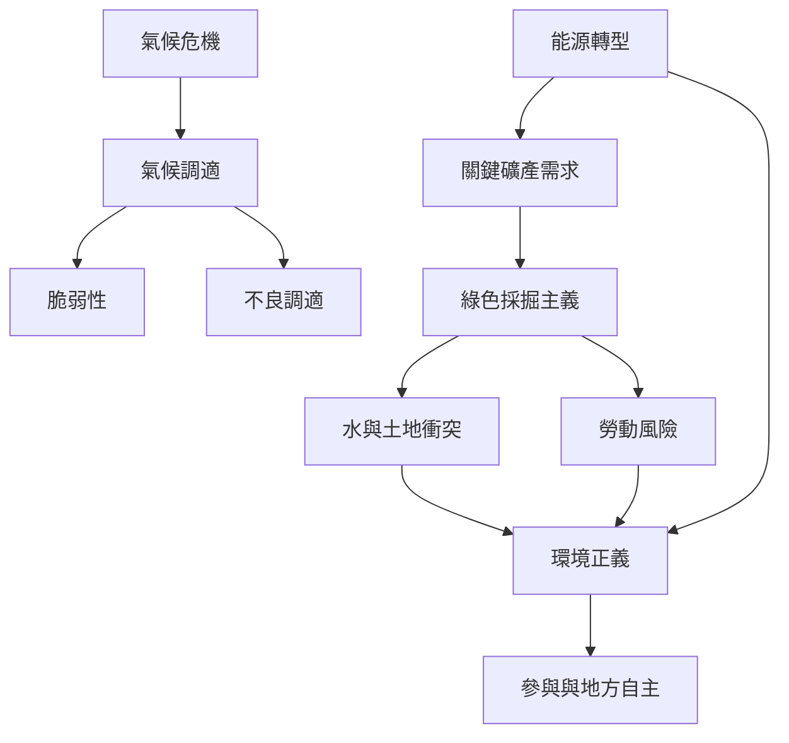

氣候危機與能源轉型涉及的不只是技術替代，也包括材料需求、全球供應鏈、地方領土權、勞動條件和調適資源的分配。政治生態學要求同時檢查減碳效益與原料端的社會生態成本，並追問調適是否造成新的脆弱性。

## 參考
* [[綠色轉型若只替換能源技術可能延續採掘主義]]
* [[氣候調適政策本身就是資源分配與政治權力的過程]]
* [[智利鋰礦展示綠色交通轉型如何把水資源壓力轉嫁給安地斯社群]]
* [[剛果民主共和國鈷礦讓能源轉型中的勞動風險重新進入視野]]
* [[斐濟氣候遷村必須以長期生活變化而非搬遷完成與否來評估]]
* [[能源正義]]、[[採掘主義]]、[[不良調適]]、[[脆弱性]]
