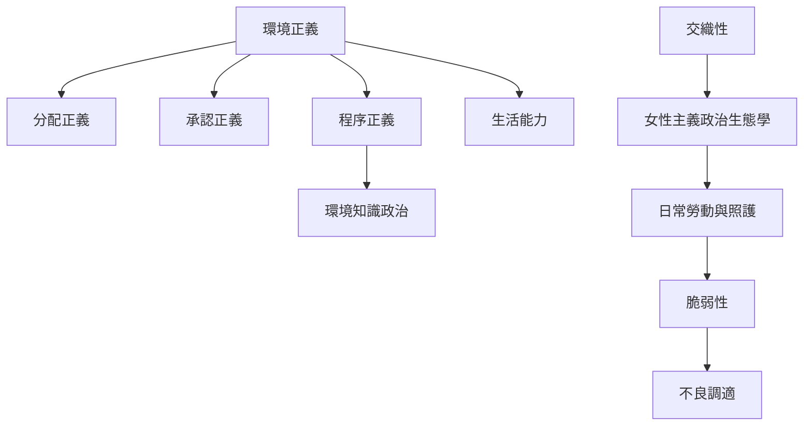

環境正義把風險、利益、承認、參與與生活能力納入同一框架。女性主義與交織性視角進一步提醒：環境影響會沿性別、階級、族群、年齡與身份差異化。脆弱性不是群體的固定屬性，而是制度和資源條件的結果。

## 參考
* [[環境正義必須同時檢查分配承認參與與生活能力]]
* [[性別化的日常勞動會改變人們承受環境變化的方式]]
* [[災害脆弱性來自長期形成的資源匱乏與制度排除]]
* [[環境政策應同時衡量生態效益民主程序與地方照護]]
* [[污染風險常沿種族階級與政治代表差異化分配]]
* [[美國環境正義運動將污染選址視為種族與階級權力問題]]
* [[環境正義]]、[[女性主義政治生態學]]、[[交織性]]、[[脆弱性]]、[[不良調適]]
