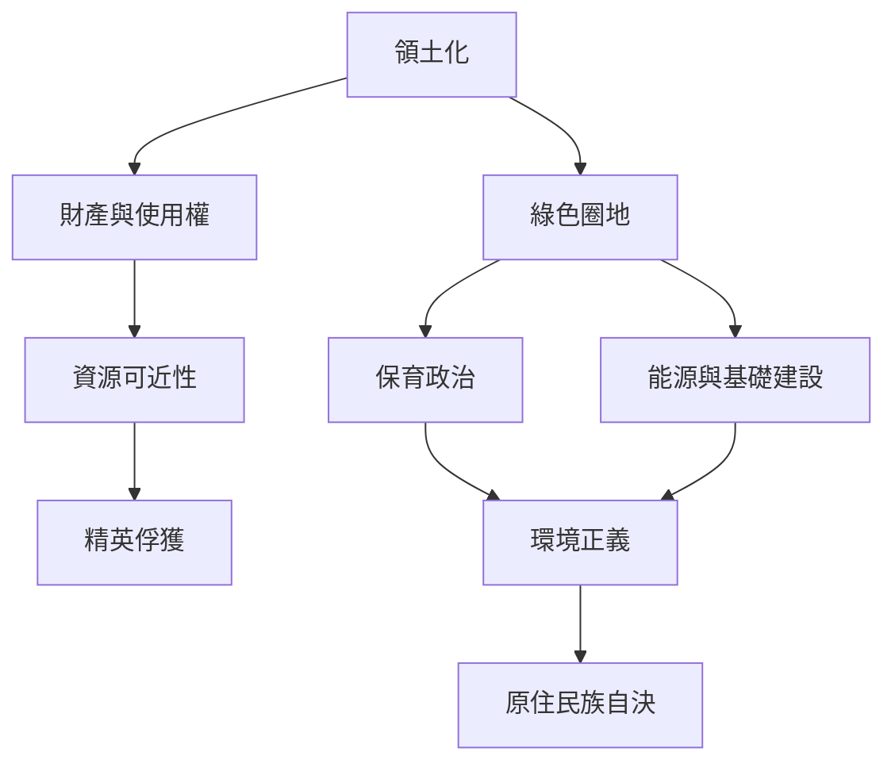

土地與資源不只是自然物質，也透過產權、行政分類、保護區、開發許可與地方規則被治理。保育、能源建設與社區資源管理都可能改變領土控制。分析時必須辨認誰能使用、誰能排除、誰能代表社群，以及制度如何讓某種空間變得可被攫取。

## 參考
* [[保育政策可能在保護自然的同時剝奪居民領土自主]]
* [[社區治理需要防止地方精英壟斷共同資源]]
* [[原住民族領土自主不應被縮減成政策諮詢或文化補償]]
* [[坦尚尼亞的保育政策可能透過領土管理逐步使原居民失去土地]]
* [[巴西亞馬遜原住民族領土治理在研究案例中有效降低森林流失]]
* [[尼泊爾社區林業可能在地方層級重建新的資源控制階序]]
* [[領土化]]、[[綠色圈地]]、[[共同資源]]、[[精英俘獲]]、[[環境正義]]
