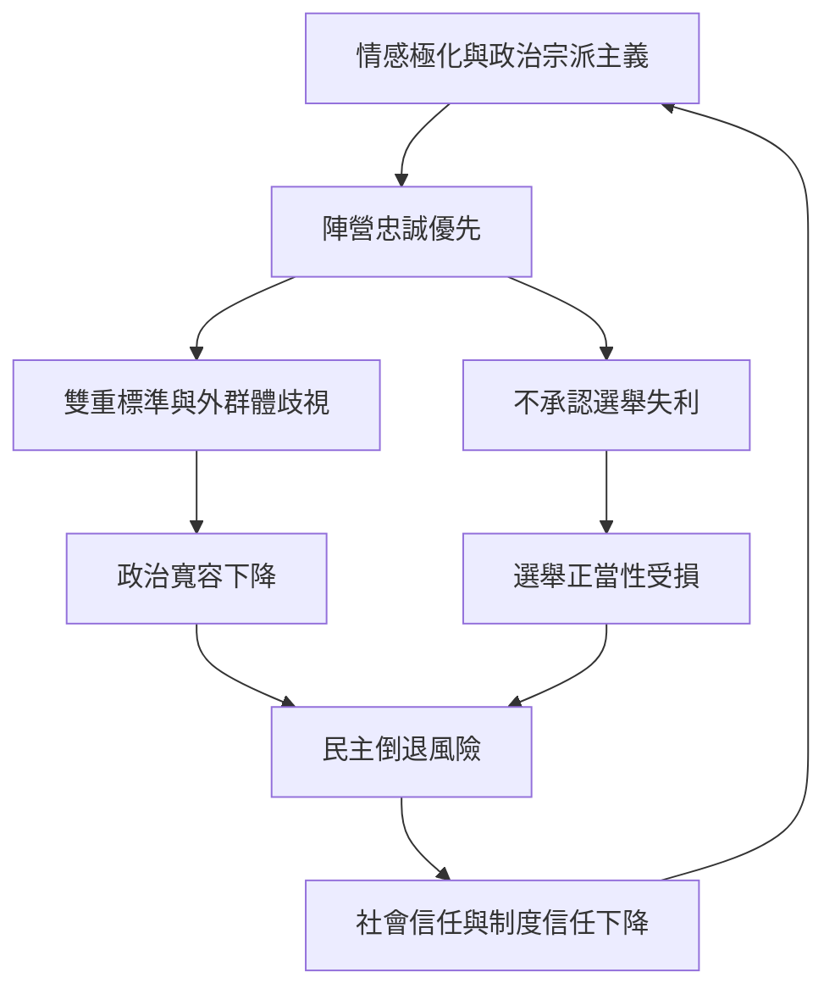

當陣營忠誠高於共同程序，政治支持者可能對己方違規寬容、對對方違規嚴苛；政治失利也更難被承認為正當結果。敵意遂從選民感受延伸到選舉公平、公民自由、司法獨立與跨群體合作，成為民主倒退的風險因素。

重要概念包括 [[政治寬容]]、[[民主倒退]]、[[政治極化]] 與 [[多元主義]]。

## 思與行
* 以跨陣營一致的程序標準評估民主，而不是以政治結果是否有利於己方判斷。
* 同時測量公民自由、選舉公平、反對黨正當性與社會互信。

## 參考
* [[土耳其的情感極化與支持反民主措施呈穩定正相關]]、[[南非的政黨競爭會沿著不同方式影響跨陣營人際信任]]、[[陣營忠誠可能讓支持者對己方違反民主原則採取雙重標準]]、[[Political_polarization]]。
