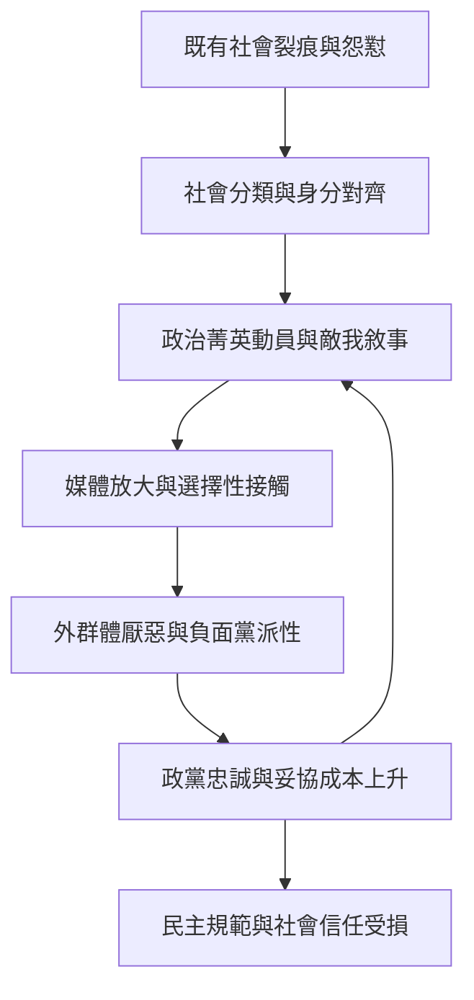

極化不是差異自動累積的結果，而是社會分類、身分重疊、政治菁英動員、媒體環境與制度誘因交互作用的過程。當多個社會裂痕排列到同一陣營、對手被道德化與威脅化、媒體反覆放大衝突時，日常政治競爭可能轉變為互不信任的敵我關係。

相關機制見 [[社會分類]]、[[社會認同理論]]、[[政治企業家]]、[[回音室]]、[[負面黨派性]] 與 [[民主倒退]]。

## 思與行
* 對案例分析使用時間序列：先前裂痕、動員策略、媒體變化、群體態度、制度後果。
* 尋找能中斷回饋的環節，而不是把責任單一歸因於選民或平台。

## 參考
* [[政治極化的危險在於社會差異被壓縮成互不信任的敵我陣營]]、[[政治菁英能把既有怨懟轉化為持續性的陣營敵意]]、[[社會身分重疊會讓政黨認同成為包覆生活的超級身分]]、[[Political_polarization]]。
