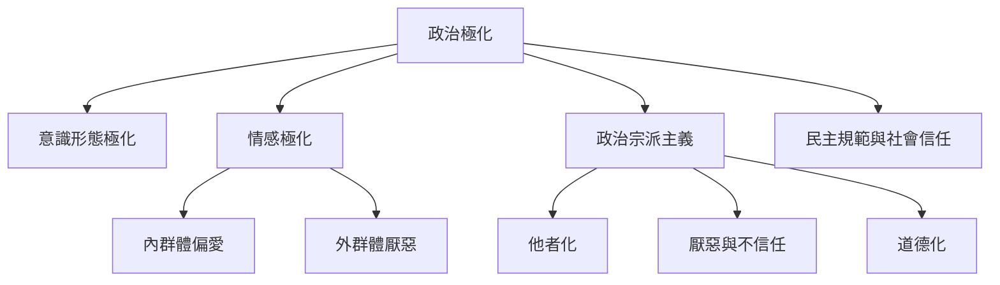

政治極化是一個多維概念。首先要區分政策位置上的意識形態極化、群體情感上的情感極化，以及把政治對手視為不正當敵人的政治宗派主義。衡量時，需同時注意內群體偏愛、外群體厭惡、社會信任與民主規範支持。

概念定義見 [[政治極化]]、[[意識形態極化]]、[[情感極化]]、[[政治宗派主義]]；量測原則見 [[政治極化需要多維度測量而不能只依賴單一指數]]。

## 思與行
* 任何研究或公共討論先說明所指的極化類型，再選擇適合的資料。
* 不要把政策衝突、群體敵意與民主倒退視為同義詞。

## 參考
* [[情感極化與意識形態極化必須分開測量]]、[[十二個民主國家的情感極化日益由外群體厭惡而非內群體熱愛驅動]]、[[V-Dem政治極化指標衡量敵意陣營如何破壞跨陣營互動]]、[[Political_polarization]]。
