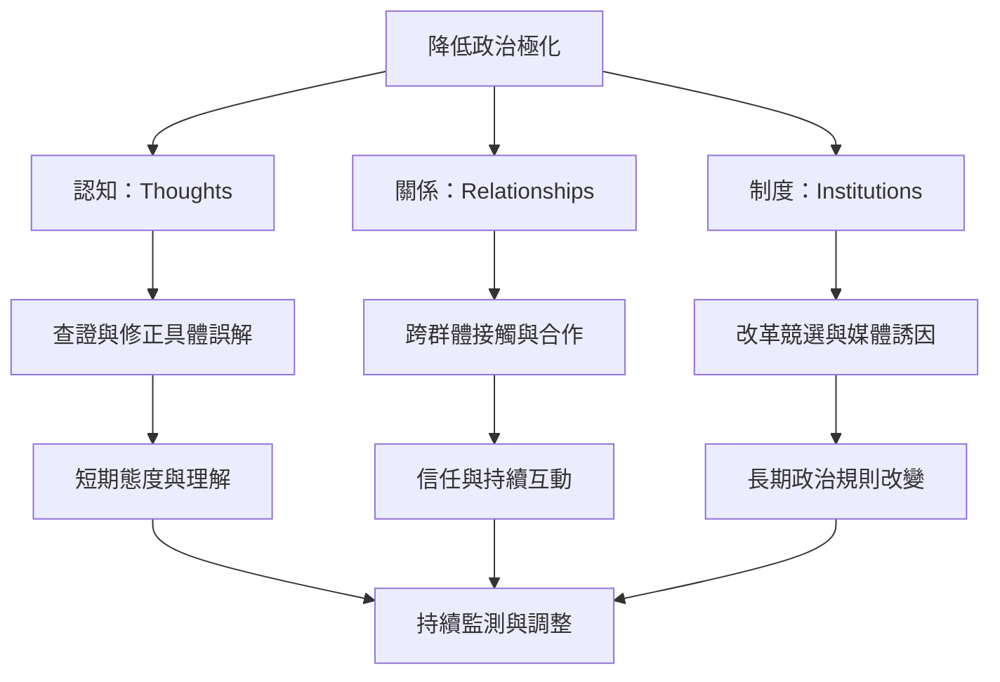

降低極化不應只依賴公民彼此友善，而應同步處理錯誤認知、群際關係與制度獎勵。資訊修復能矯正可查證的誤解；跨群體接觸與共同任務能提供反覆互動；制度改革則降低政治人物從敵意動員中獲利的誘因。

三層策略連結 [[錯誤資訊]]、[[跨群體接觸]]、[[審議民主]]、[[政治寬容]] 與 [[多元主義]]。

## 思與行
* 先診斷極化問題的主要來源，再配置三層策略及相應指標。
* 檢查參與者權力是否平等、介入效果是否持久，以及制度是否仍獎勵敵意。

## 參考
* [[反極化策略可分為認知關係與制度三個層次]]、[[減少政黨敵意的個人介入效果通常小而且很快衰退]]、[[跨群體合作能創造超越政黨標籤的共同身分]]、[[Political_polarization]]。
