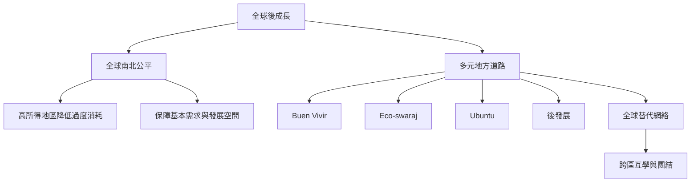

後成長若要成為全球公平的轉型，就不能把高所得國的減量要求照搬到仍缺乏基本服務的地區。Buen Vivir、Eco-swaraj、Ubuntu 及各地社區實踐提供多元的生活與治理想像。這些傳統應被放在各自脈絡中理解，再透過平等互學形成跨區合作。可先讀 [[印度與不丹經驗提醒後成長必須尊重不同發展脈絡]]。

相關文獻：[[中美洲社區氣候行動為後發展提供在地實踐]]、[[印度Vikalp Sangam以生態自治連結社區民主]]、[[全球替代網絡讓地方實踐互學而不必複製同一模式]]。
