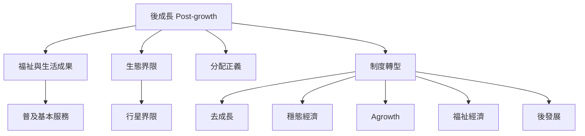

後成長不是單一經濟方案，而是把福祉目標、生態限制、分配正義與制度轉型放在一起思考的研究領域。這張地圖從概念核心出發，連結各種經濟思想及其差異。可先讀 [[後成長研究已把福祉置於行星界限之內]]，再比較 [[去成長]]、[[穩態經濟]]、[[Agrowth]]、[[福祉經濟]] 與 [[後發展]]。

延伸閱讀可搭配 [[後成長不是一種單一政策而是一個仍在爭論的研究領域]] 與 [[福祉經濟與去成長可以合作但不能視為同一立場]]。
