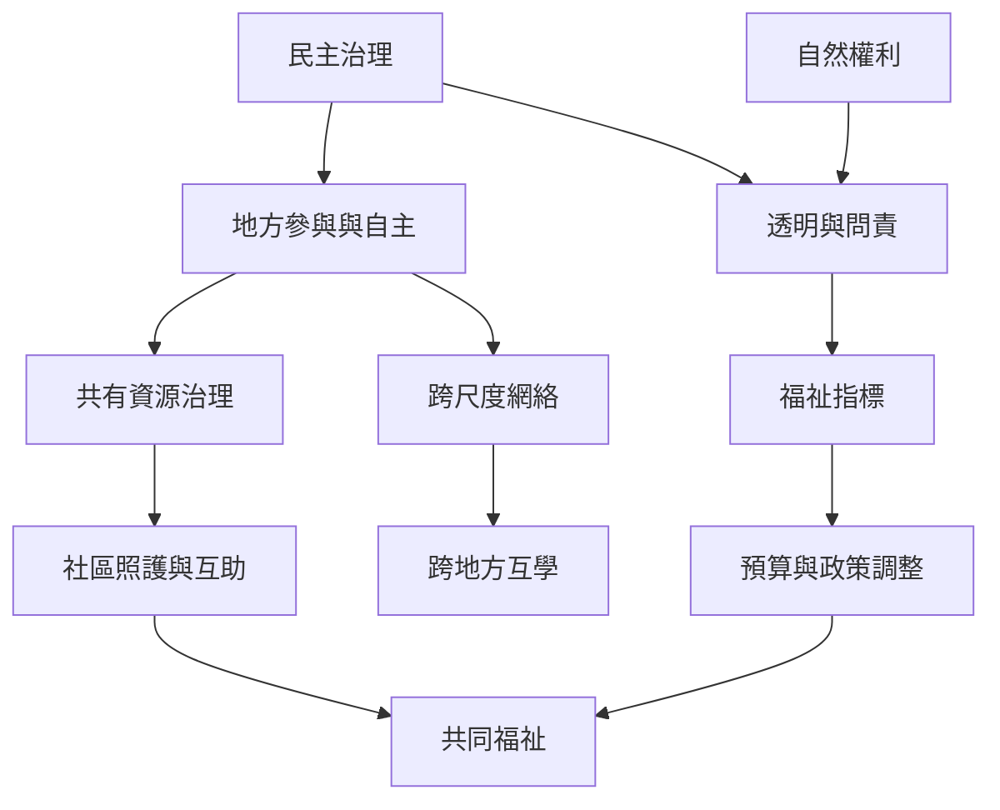

後成長不是只靠專家模型或中央政府政策完成，還需要讓受影響者參與問題定義、資源配置與成果評估。地方自治、共有資源治理、自然權利與福祉指標，能提供社區參與制度轉型的入口，但都需要權力制衡、代表性與持續問責。可先讀 [[印度Vikalp Sangam以生態自治連結社區民主]] 與 [[威爾斯以未來世代福祉法制化長期政策責任]]。

行動入口：[[從社區共享開始練習後成長而不是從個人禁慾開始]]、[[建立台中社區福祉儀表板讓生活成果取代成長敘事]]、[[建立一份能揭露政策受益者與承擔者的轉型檢核表]]。
