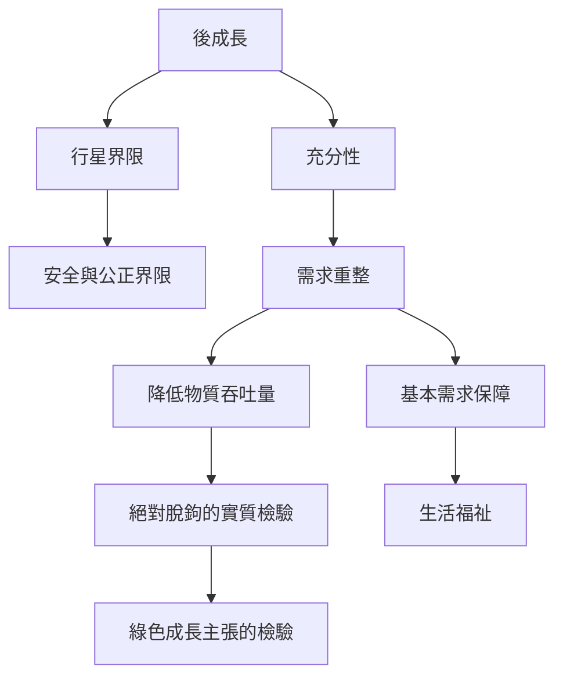

這張地圖整理生態界限、資源吞吐量、脫鉤與需求轉型的關係。核心問題是：環境壓力是否以足夠速度絕對下降，並且在公平的生態預算內滿足基本需求。可搭配 [[高所得國已達成的碳脫鉤速度不足以符合巴黎公平碳預算]]、[[地球系統界限必須同時考慮安全與公正]] 及 [[基本需求可被滿足但各國生態壓力差異巨大]] 閱讀。

相關概念包括 [[生態經濟學]]、[[絕對脫鉤]]、[[生態足跡]]、[[綠色成長]] 與 [[充分性]]。
