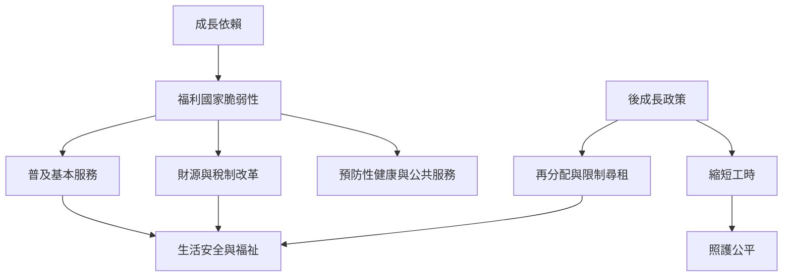

後成長的政策可行性取決於社會能否在不依賴 GDP 持續擴張時維持就業、公共財政與基本服務。這張地圖把福利國家成長依賴、普及基本服務、工作時間、照護與分配政策放在同一制度框架。可先讀 [[福利國家必須解除就業財源與公共服務的成長依賴]]。

延伸筆記：[[縮短工時必須和收入安全與照護公平一起設計]]、[[無酬照護是經濟運作的基礎而不是外部成本]]、[[普及基本服務能讓福祉不必完全依賴市場所得]]。
