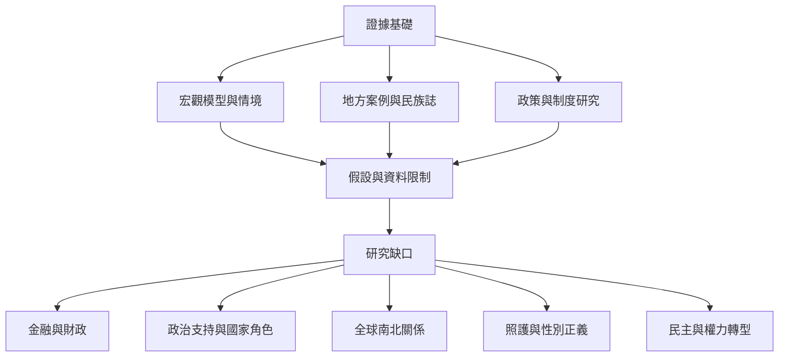

後成長研究快速發展，但它不是已被完整實驗驗證的制度藍圖。模型可以檢查經濟與生態結果，案例可呈現部分實踐，政策研究能辨認制度依賴；然而金融穩定、政治支持、全球南北互動、國家角色、照護與勞動等議題仍需更多研究。閱讀時應同時保留研究成果、方法限制與價值爭論。

可搭配 [[2026年後成長研究仍需要公開檢驗證據與方法]]、[[後成長模型必須同時呈現生物物理經濟與社會系統]] 及 [[七十五項模型研究顯示後成長政策仍有明顯建模缺口]]。
