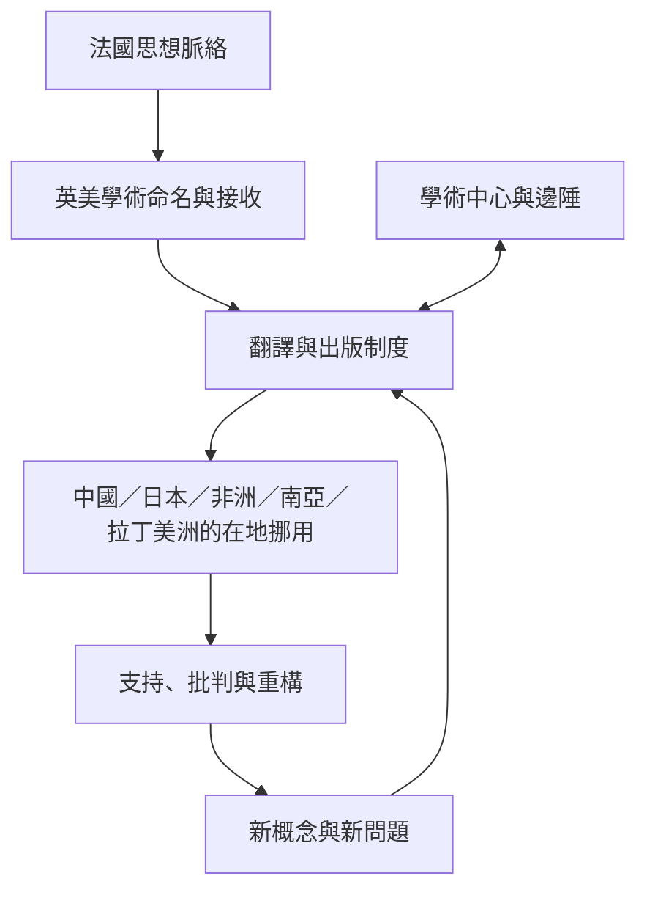

本圖聚焦理論如何跨越語言、地區與學術制度，並在翻譯、挪用、批評和在地實踐中改變。全球南方不是同質場域，接受史必須保留地區差異。

## 關係圖

## 延伸閱讀
- [[中國對傅柯的接受隨政治與學術語境變動]]
- [[日本的德希達接受使翻譯本身成為哲學問題]]
- [[非洲思想界對後結構主義與後殖民理論的接受並不一致]]
- [[拉丁美洲後殖民與去殖民論爭涉及學術位置]]
- [[理論旅行會在翻譯中產生新的知識形態]]

[[Post-structuralism]]
