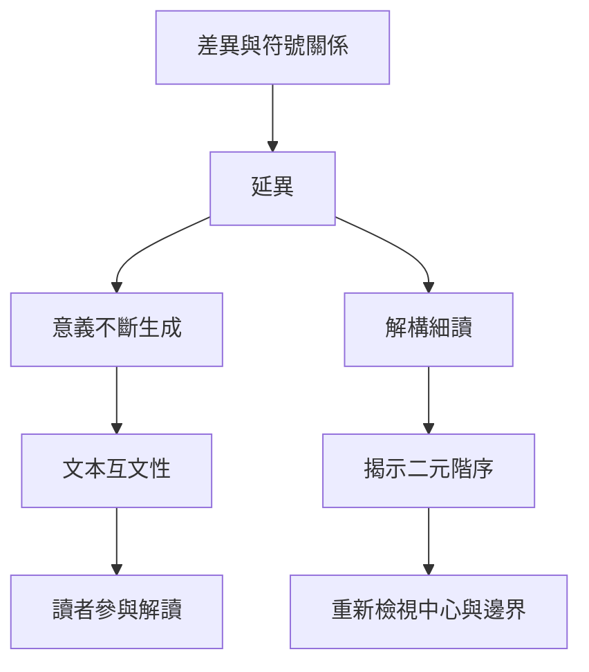

本圖整理語言與意義如何從差異關係中生成，以及解構、互文性和作者位置如何改變閱讀方法。閱讀時要同時保留文本證據與語境限制。

## 關係圖

## 延伸閱讀
- [[德希達以延異與解構揭示意義的差異性]]
- [[巴特以作者之死改寫文本意義的來源]]
- [[文本意義受語境與互文關係共同限制]]
- [[解構檢視二元對立如何安排權力階序]]
- [[解構不等於任意解讀]]

[[Post-structuralism]]
