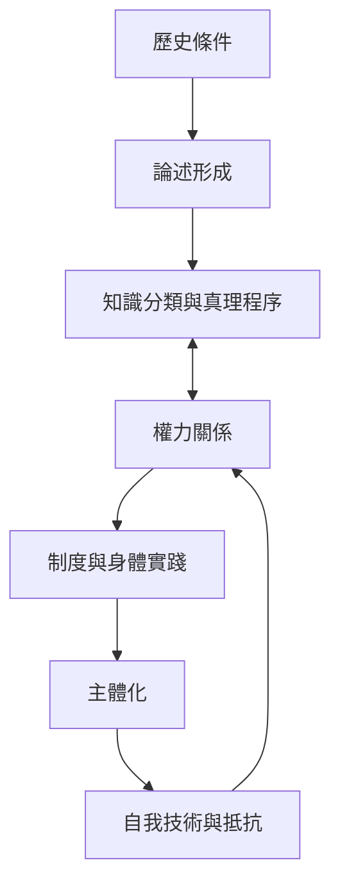

本圖以傅柯研究為主軸，展示論述、知識制度、權力技術與主體形成如何互相構成。它不是單向因果模型，而是可循環、可變動的關係網。

## 關係圖

## 延伸閱讀
- [[傅柯以考古學與系譜學研究知識形成]]
- [[傅柯將權力理解為生產關係而非單純壓制]]
- [[論述界定某個時代可說與可想的範圍]]
- [[權力不只壓制也生產知識與主體]]
- [[主體化是權力關係與自我實踐交織的過程]]

[[Post-structuralism]]
