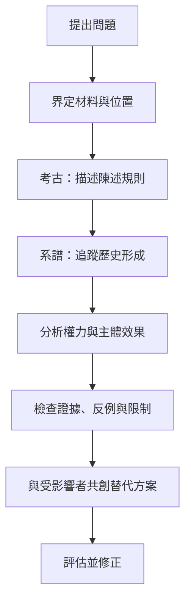

本圖把考古學、系譜學、話語分析、反身性和行動設計連成一條研究工作流。方法不是只會辨識權力，還需交代材料、研究者位置、證據標準及可實踐的替代方向。

## 關係圖

## 延伸閱讀
- [[傅柯式話語分析須追蹤可說性與主體位置]]
- [[研究方法必須說明材料和分析步驟]]
- [[讓研究者位置成為研究方法的一部分]]
- [[後真相時代的話語研究仍需說明證據與真理標準]]
- [[把批判分析接到可測試的制度改變]]

[[Post-structuralism]]
