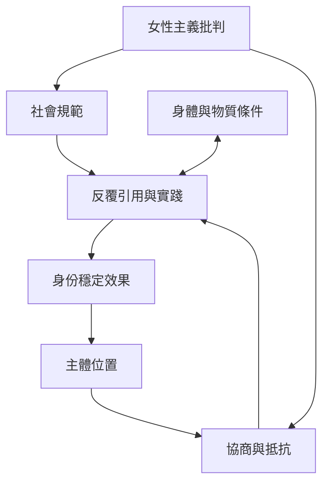

本圖將反本質主義、性別操演、主體化與女性主義政治連在一起，強調身份一方面由規範反覆形成，另一方面也可能透過實踐與集體行動改變。

## 關係圖

## 延伸閱讀
- [[巴特勒以性別操演論挑戰固定身份]]
- [[韋登把後結構主義轉化為女性主義實踐]]
- [[身份是規範反覆引用後形成的效果]]
- [[性別操演不是個人任意扮演角色]]
- [[反本質主義不能忽略身體和物質條件]]

[[Post-structuralism]]
