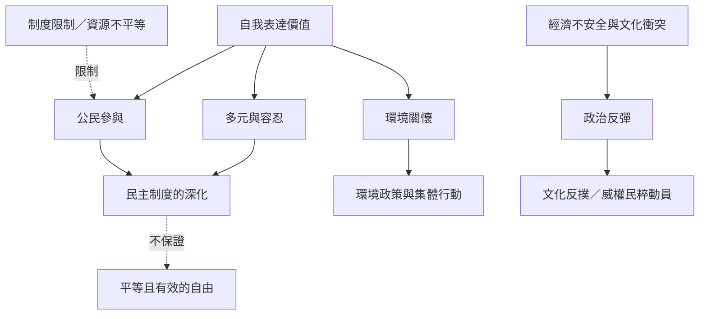

這張地圖說明後物質主義與自我表達價值如何被連結到民主、公民參與、環境關懷及文化反撲。關鍵區分是：價值偏好不等於實際行動，更不等於制度結果。先讀 [[自我表達價值把生活品質帶入公共政治]] 與 [[自由需要資源價值與制度三者共同支撐]]。

這不是必然進程圖。公民參與可能被壓抑，環境關懷也可能出自生計風險；文化反撲則需要結合政黨、媒體、經濟與制度條件解釋。延伸閱讀：[[環境關懷不是後物質主義者的專利]]、[[文化反撲不是價值進步必然逆轉的證據]]、[[把生活安全視為參與公共生活的基礎設施]]。
