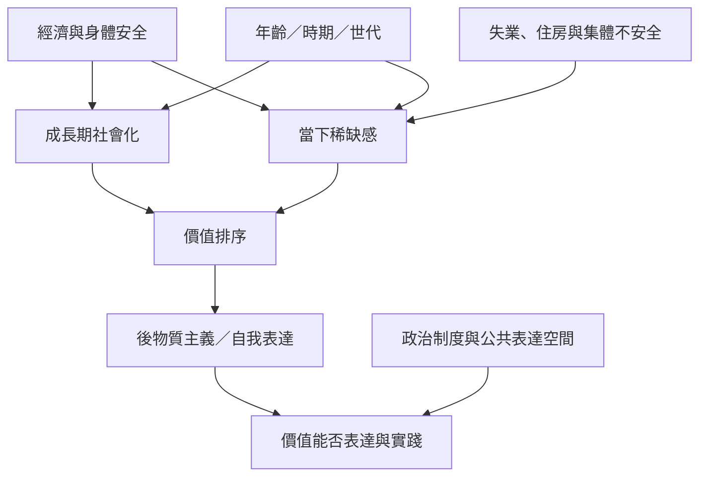

這張地圖聚焦後物質主義的核心機制：資源與安全如何影響價值優先序，以及這種關係為何會因歷史時期、社會階層與政治制度而改變。可從 [[物質安全不是價值的反面而是價值形成的條件]] 開始，再比較 [[後物質主義不是世代更替的單一結果]]。

閱讀時不要把圖理解成機械式單向因果。稀缺感、社會化與制度環境可能互相影響；價值也可能透過政治行動反過來改變制度。延伸閱讀：[[經濟不安全會使自由選擇退居求生]]、[[政治制度會影響價值的形成與公開表達]]、[[價值變遷必須拆解年齡時期與世代效應]]、[[自由需要資源價值與制度三者共同支撐]]。
