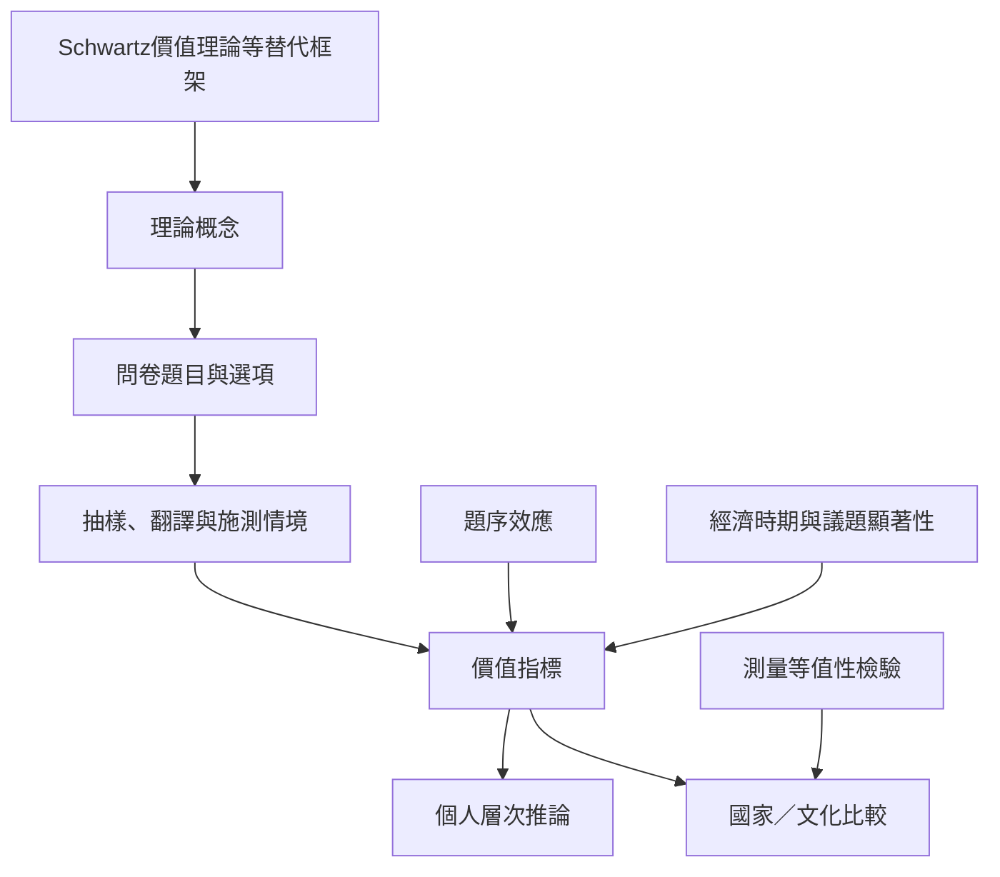

這張地圖整理後物質主義研究的證據品質問題：指標如何建構、調查工具如何影響結果、跨文化可比性如何成立，以及不同理論是否測量同一種價值。閱讀順序建議先看 [[測量價值必須同時檢查題目與抽樣脈絡]]，再看各種效度批評與回應。

研究成果必須說明資料版本、樣本、題目版本、缺失值、權重與測量等值性。國家平均值不應被當成國民性格。延伸閱讀：[[四題後物質主義指標的效度長期受到質疑]]、[[後物質主義指標的支持者以選擇題邏輯回應效度批評]]、[[問卷題序本身可能放大後物質價值的比例]]、[[跨國比較不能把量表分數當成文化本質]]。
