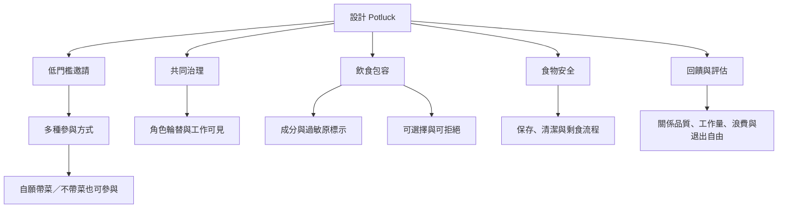

將研究轉化為聚餐實作時，需要同時處理低門檻參與、勞務分配、飲食包容、食物安全、文化尊重、共同治理與活動評估。好的 Potluck 不必規模龐大或流程複雜；重要的是讓人能以不同方式參與、共同維護資源，也能自在退出。

重要概念：[[Potluck]]、[[Hospitality（款待）]]、[[Consent（同意）]]、[[Autonomy（自主）]]、[[Care economy（照顧經濟）]]、[[Volunteerism（志願服務）]]、[[Participatory governance（參與式治理）]]、[[Food safety（食品安全）]]、[[Allergen cross-contact（過敏原交叉接觸）]]、[[Dietary inclusion（飲食包容）]]、[[Evaluation（評估）]]、[[Mutual aid（互助）]]。

實作起點：[[把每月 Potluck 設計成低門檻的共同生活實驗]]；檢查公平：[[讓不帶菜的人也能完整參與 Potluck]]、[[讓組織工作輪替以防止互助社群耗竭]]；檢查安全：[[為共享餐桌建立一份簡單而可修改的食安約定]]。

回到全書：[[Potluck]]。
