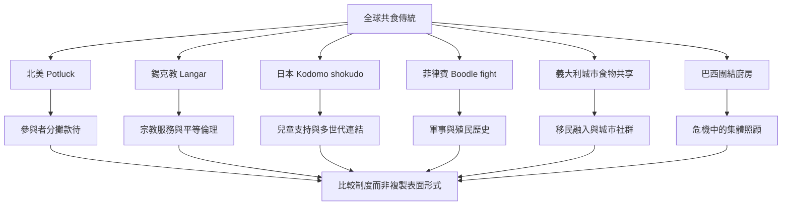

全球共享餐食有多種形式，從日常鄰里分享到宗教公共廚房、兒童食堂、移民互助餐桌與節慶宴席。比較時應區分食物提供方式、制度脈絡、宗教意義、參與權與歷史記憶，不將不同傳統視為 Potluck 的地方版本。

重要概念：[[Potluck（分享餐／百樂餐）]]、[[Commensality（共同用餐）]]、[[Potluck]]、[[Langar（錫克教公共廚房）]]、[[Seva（無私服務）]]、[[Kodomo shokudo（日本兒童食堂）]]、[[Community kitchen（社區廚房）]]、[[Boodle fight（菲律賓共享餐桌形式）]]、[[Food memory（食物記憶）]]、[[Oral history（口述歷史）]]、[[Cultural appropriation（文化挪用）]]、[[Social inclusion（社會包容）]]、[[Conviviality（共融生活／共同歡愉）]]。

閱讀提示：先讀 [[世界各地的共食形式不能被誤認為 Potluck 的地方版本]]，再依個別案例閱讀 [[錫克教 Langar 以免費共食實踐平等與服務]]、[[日本兒童食堂將共餐延伸為跨世代的社區支持]]、[[菲律賓 Boodle Fight 的共享餐桌也承載軍事與殖民歷史]]。

回到全書：[[Potluck]]。
