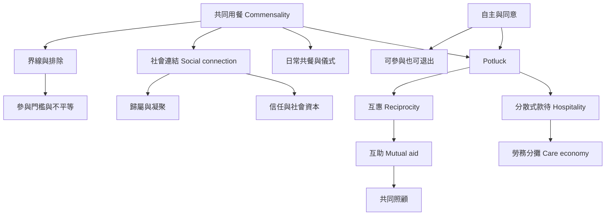

共同用餐（commensality）不只是同時進食，而是透過食物、時間、空間與規範組織社會關係的過程。Potluck 是其中一種分散式款待形式；共同用餐可能增加社會連結與歸屬，也可能放大界線、權力和不平等。

重要概念：[[Potluck（分享餐／百樂餐）]]、[[Commensality（共同用餐）]]、[[Potluck]]、[[Hospitality（款待）]]、[[Conviviality（共融生活／共同歡愉）]]、[[Social connection（社會連結）]]、[[Social capital（社會資本）]]、[[Social cohesion（社會凝聚）]]、[[Reciprocity（互惠）]]、[[Mutual aid（互助）]]、[[Care economy（照顧經濟）]]、[[Social reproduction（社會再生產）]]、[[Autonomy（自主）]]、[[Consent（同意）]]、[[Social inclusion（社會包容）]]、[[Social exclusion（社會排除）]]。

閱讀提示：先讀 [[跨越 142 個國家的資料顯示共享餐食與主觀幸福感穩定相關]]，再讀 [[共同用餐研究需要同時看見凝聚力與排斥性]] 和 [[智利聖地牙哥訪談呈現共同用餐的凝聚與緊張並存]]。若要把理論轉為活動設計，接續閱讀 [[Potluck 的核心是共同承擔款待勞務]]、[[共享餐桌需要看見不可見的照顧工作]]。

回到全書：[[Potluck]]。
