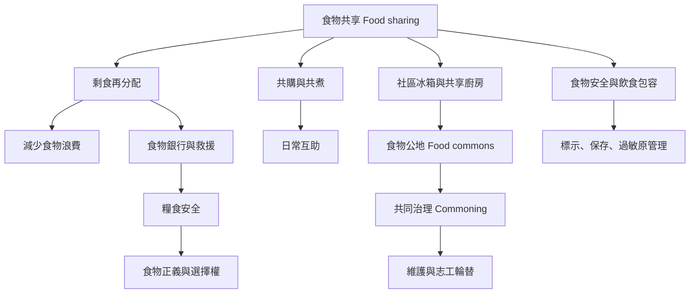

食物共享涵蓋個人分享、家庭共購、社區共煮、食物銀行、社區冰箱與公共廚房。當食物從私人資源轉為共享資源，群體必須協商使用權、食物安全、勞務分配與治理規則。食物救援亦需回應糧食安全、尊嚴和選擇權，而非只追求食物被轉移或浪費量下降。

重要概念：[[Food sharing（食物分享）]]、[[Food commons（食物公有資源／食物共享公地）]]、[[Commoning（共有化實踐）]]、[[Food security（糧食安全）]]、[[Food sovereignty（糧食主權）]]、[[Food justice（食物正義）]]、[[Food waste（食物浪費）]]、[[Surplus food redistribution（剩餘食物再分配）]]、[[Community kitchen（社區廚房）]]、[[Participatory governance（參與式治理）]]、[[Food safety（食品安全）]]、[[Allergen cross-contact（過敏原交叉接觸）]]、[[Dietary inclusion（飲食包容）]]、[[Solidarity economy（團結經濟）]]、[[Cooperative economy（合作經濟）]]。

閱讀提示：由 [[台灣家庭剩食研究指出共享食物可結合共購與共煮]] 了解家庭尺度，再讀 [[社區冰箱需要持續的共同維護而不只是放置一台冰箱]] 和 [[巴西疫情期間的團結廚房把供餐延伸為社區支持]]，最後以 [[食物共享應保留受助者的選擇權]] 檢查制度是否尊重需求者。

回到全書：[[Potluck]]。
