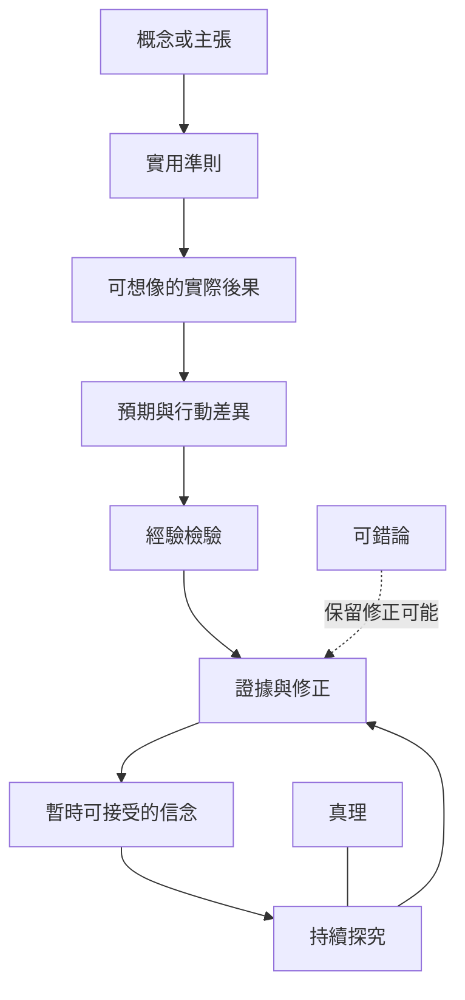

實用主義對概念意義與真理提出兩個相連但不可混為一談的問題：一個概念可能造成什麼實踐差異？一個信念如何在探究中獲得可靠支持？前者關乎意義澄清，後者關乎真理與證成。

## 思與行
* 閱讀理論時，將「意義」「證成」「真理」「成功」分欄記錄。
* 不以一次行動成功取代長期證據。

## 參考
* [[皮爾士的實用準則要求追問概念可能造成的實踐差異]]。
* [[實用主義真理論的爭議在於探究成功與客觀真實如何連結]]。
* [[實用準則]]、[[實際後果]]、[[真理]]、[[可錯論]]。
