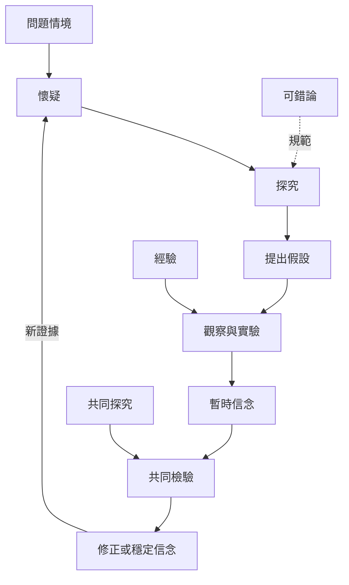

實用主義把知識形成理解為從懷疑和問題情境出發、經由共同探究與實驗、再依證據修正信念的過程。這張地圖聚焦 Peirce 與 Dewey 的探究模型，以及可錯論如何支撐持續學習。

## 思與行
* 將研究流程設計成可回溯循環，而非線性「找答案」程序。
* 將反證、未解問題與修訂日期放入筆記結構。

## 參考
* [[皮爾士以信念形成與探究方法區分四種固定意見的方式]]。
* [[杜威把知識理解為人在不確定情境中進行的實驗性探究]]。
* [[探究]]、[[共同探究]]、[[可錯論]]、[[懷疑]]、[[信念]]、[[經驗]]。
