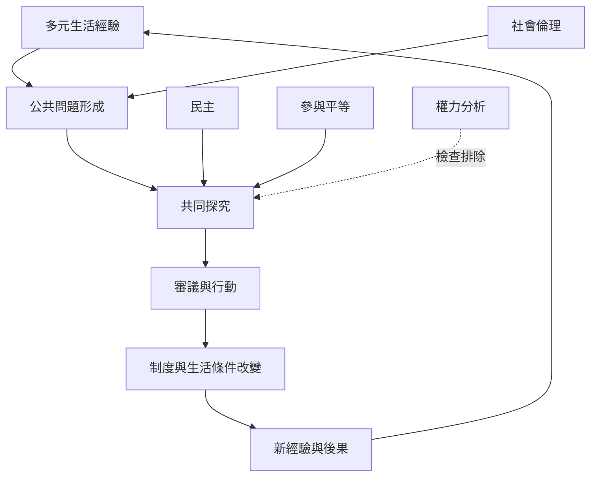

Dewey 與 Addams 將實用主義從個人認知延伸到共同生活：民主需要人們分享經驗、共同定義問題與修正制度；社會倫理則要求看見個人與制度之間的相互依賴。

## 思與行
* 評估公共參與時，不只看是否舉辦會議，也看誰能參與、誰能定義問題。
* 將回饋機制與受影響者的補救權納入制度設計。

## 參考
* [[珍亞當斯以赫爾館實踐把社會倫理變成共同生活的改革]]。
* [[杜威的民主教育把學習設計成共同探究與共同生活]]。
* [[民主]]、[[社會倫理]]、[[共同探究]]、[[經驗]]。
