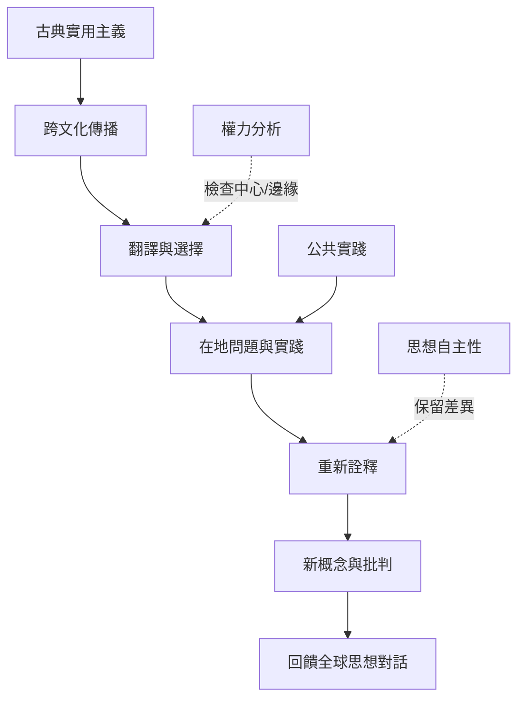

實用主義的全球歷史應被理解為多向交流與在地轉化，而非單一中心向外擴散。中國的教育改革、拉丁美洲的哲學再定位，以及非裔思想傳統與實用主義的對話，都展示思想接受者具有創造與批判能力。

## 思與行
* 同時整理原典、翻譯、接收者、實作者與批評者。
* 避免將思想者只按師承或相似性分類。

## 參考
* [[胡適與陶行知把杜威思想轉化為中國教育改革的實踐資源]]。
* [[拉丁美洲的實用主義研究挑戰實用主義只屬於北美的敘事]]。
* [[非裔思想傳統與實用主義的關係需要互相對話而非單向收編]]。
* [[思想跨文化傳播會在接收情境中重新塑形]]。
