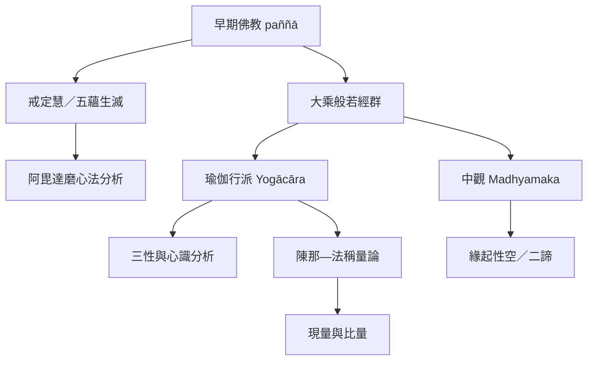

印度佛教關於智慧的討論，從早期經典的 *paññā* 發展出阿毘達磨分析、大乘般若經群、中觀與瑜伽行派等多條路線。後期佛教量論則把可靠認知、現量與比量的問題推向更細緻的哲學論證。這些路線彼此交流，但不是單線演化，也不是同義詞的集合。

主要比較：[[巴利語paññā與梵語prajñā相通但歷史語境不宜直接混同]]、[[不同佛教傳統以不同路徑呈現智慧但共享解脫與轉化關懷]]、[[佛教智慧論也是對可靠認知來源的哲學探問]]。
