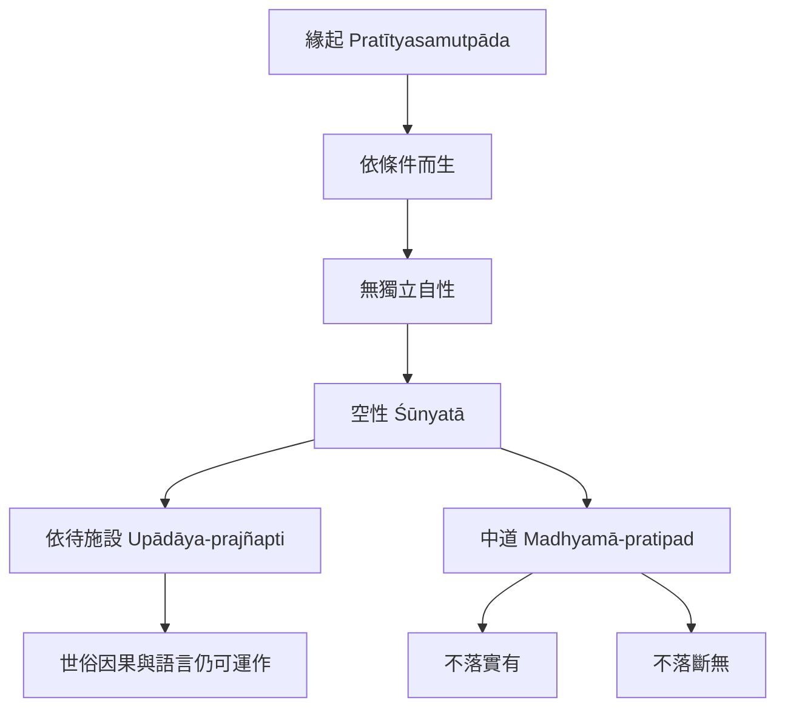

中觀的核心關係不是「空性取代緣起」，而是以緣起說明諸法何以無自性，並以依待施設說明世俗命名與因果作用仍然有效。理解此圖時需避免把空性誤作虛無。

## 概念連結
* [[緣起 Pratītyasamutpāda]]
* [[空性 Śūnyatā]]
* [[中道 Madhyamā-pratipad]]
* [[依待施設 Upādāya-prajñapti]]
* [[無我 Anātman]]

## 參考
* [[中觀以緣起說明空性而不把空性等同虛無]]
* [[正見以生起與止息超越有無二邊]]
* [[Pratītyasamutpāda]]
