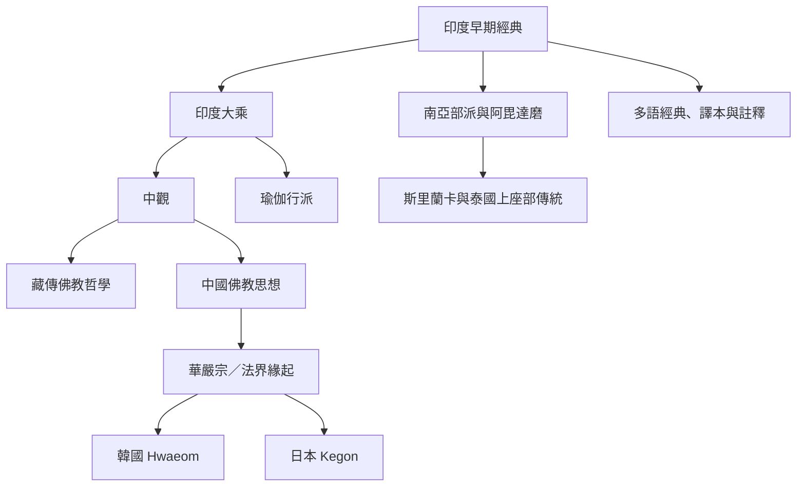

這張地圖比較南亞早期經典與論書、泰國上座部教學、印度中觀與瑜伽行派、中國華嚴、藏傳佛教，以及韓國、日本等地的傳承與學術研究。它強調傳統之間既有文本連續，也有在地創造與翻譯差異。

核心入口：[[緣起]]、[[華嚴宗]]、[[中觀]]、[[瑜伽行派]]、[[法界緣起]]。

## 延伸連結
* [[note/多語翻譯會改變緣起概念的理解路徑|多語翻譯]]、[[note/華嚴法界緣起把相互依存推演為事事無礙|華嚴法界緣起]]。
* [[note/三世兩重因果是歷史形成的解釋框架|上座部與部派傳統]]、[[note/中觀以空性說明事物不具自性但仍可依緣起作用|中觀]]。
* [[idea/舉辦多語概念對讀工作坊|多語對讀工作坊]]。

## 原典與研究
* [[data/泰國佛教傳統以當下觀察倡導實踐性緣起|泰國 Buddhadāsa 與 Payutto]]。
* [[data/藏傳佛教以十二支說明輪迴並以空性校正實有見|藏傳佛教教材]]。
* [[data/華嚴以法界緣起說明事事無礙|華嚴哲學研究]]。
* [[data/日本佛教學術研究指出緣起偈在中日藏註釋中的多重讀法|中日藏詮釋比較]]。
