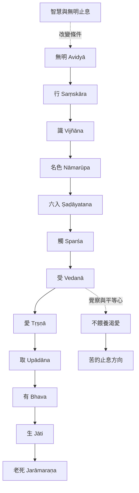

此圖將十二支作為閱讀與觀察工具。正向箭頭呈現苦的條件鏈，逆向理解則從無明止息開始看見整體苦的止息。箭頭表現條件關係，不應被誤讀為每個心理事件都機械地依序發生。

## 概念連結
* [[無明 Avidyā]]
* [[行 Saṃskāra]]
* [[識 Vijñāna]]
* [[名色 Nāmarūpa]]
* [[六入 Ṣaḍāyatana]]
* [[觸 Sparśa]]
* [[受 Vedanā]]
* [[愛 Tṛṣṇā]]
* [[取 Upādāna]]
* [[有 Bhava]]
* [[生 Jāti]]
* [[老死 Jarāmaraṇa]]

## 參考
* [[十二支應視為觀察條件的模型而非僵硬時間表]]
* [[受與愛之間存在可觀察的修行轉折點]]
* [[Pratītyasamutpāda]]
