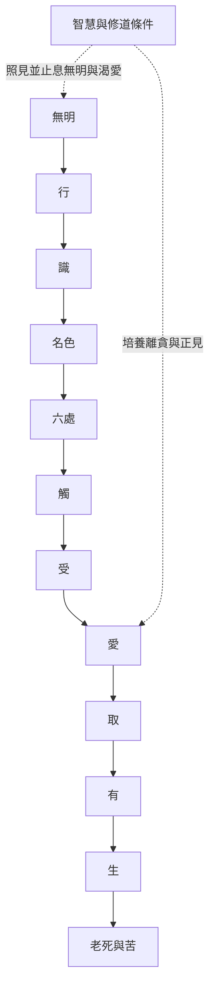

這張概念地圖整理早期經典如何以條件性說明苦的生起與止息，並聚焦十二支、順觀逆觀、無我與中道。閱讀時先回到經文，再比較後世論釋，不將三世或當下詮釋直接當成唯一原義。

核心入口：[[緣起]]、[[十二支]]、[[條件性]]、[[四聖諦]]、[[無我]]。

## 延伸連結
* [[note/緣起首先指向苦的條件性生起與止息|緣起的核心目的]]、[[note/十二支是理解苦流的分析框架而非僵硬時間表|十二支的解讀方法]]。
* [[note/當下觀察與跨生死解讀回答不同尺度的問題|不同時間尺度]]、[[note/觀受與愛之間的條件能提供修行觀察入口|觀受與愛]]。
* [[idea/以十二支繪製一次日常情緒反應的條件圖|日常情緒觀察]]、[[idea/從受與愛之間練習辨認選擇空間|受與愛的練習]]。

## 原典與研究
* [[data/早期經典以條件關係描述苦的生起與止息|SN 12.1]]。
* [[data/分別緣起經逐項界定十二支的意義|SN 12.2]]。
* [[data/迦旃延氏經以緣起指出有無二邊之外的正見|SN 12.15]]。
