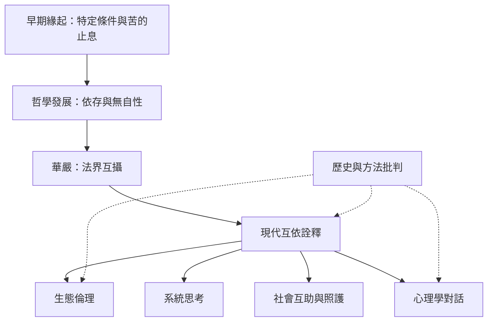

當代思想常將緣起延伸到生態互依、社會系統、心理學與公共倫理。這些工作能產生重要洞見，但需區分早期經典教義、後期華嚴哲學與現代跨學科詮釋。這張地圖提供對話方式，而非宣稱三者完全同義。

核心入口：[[生態互依]]、[[法界緣起]]、[[互即互入]]、[[緣起]]。

## 延伸連結
* [[note/互依倫理是有價值的現代延伸但不等於早期十二支|互依倫理的界線]]。
* [[note/經驗研究不應把佛教緣起直接等同現代科學因果|科學比較的限制]]。
* [[idea/將生態互依轉成可驗證的照護行動|生態行動]]、[[idea/把社群衝突拆成條件網絡以減少責怪|社群系統]]。
* [[data/互依不能直接等同早期十二支緣起|Anālayo 的批判性論文]]、[[data/Joanna Macy以互依因果連結佛教與一般系統理論|Macy 的跨學科著作]]。
