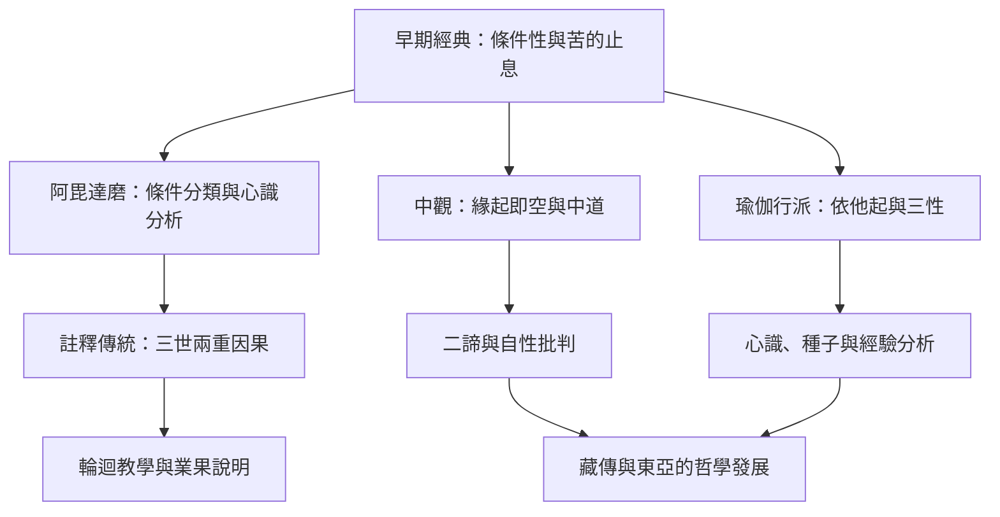

此圖呈現緣起從早期經典的苦集與苦滅分析，經由部派論書、上座部註釋與大乘哲學逐步展開的路徑。它不是單線進步史，而是多種詮釋針對不同問題所作的回應。

核心入口：[[緣起]]、[[中道]]、[[空性]]、[[二諦]]、[[依他起性]]。

## 延伸連結
* [[note/三世兩重因果是歷史形成的解釋框架|三世兩重因果]]、[[note/中觀以空性說明事物不具自性但仍可依緣起作用|中觀與空性]]。
* [[note/唯識以依他起性分析經驗如何被條件組織|瑜伽行派]]、[[note/中道拒絕把存在與不存在當成唯一選項|中道]]。
* [[idea/用雙欄表比較經典脈絡與現代延伸|雙欄研究方法]]。

## 原典與研究
* [[data/聖安德魯斯百科呈現緣起思想的歷史分層|Jones 2024 歷史綜述]]。
* [[data/部派與上座部論釋發展三世兩重因果的解讀|三世解讀研究]]。
* [[data/中觀以緣起與空性建立中道|龍樹研究]]。
* [[data/瑜伽行派以依他起性分析經驗如何依條件形成|瑜伽行派研究]]。
