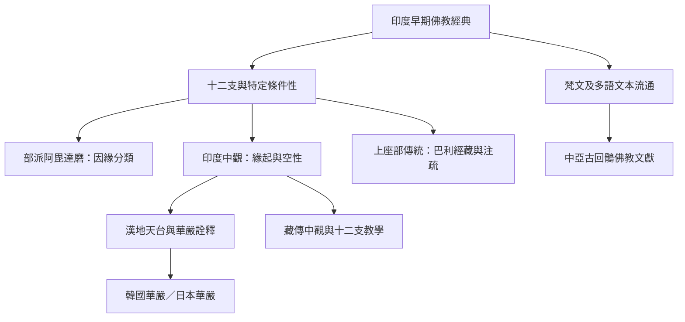

此圖不是單線進化史，而是把重要傳統放在彼此有關聯、但各自形成的歷史分支中。早期經典提供緣起與十二支的核心語彙；部派阿毘達磨細分條件；中觀、華嚴與藏傳在不同歷史與教學環境中發展詮釋；中亞文獻呈現跨語言流通。

## 概念連結
* [[緣起 Pratītyasamutpāda]]
* [[法界 Dharmadhātu]]
* [[部派阿毘達磨把因果關係細分為多種條件類型]]
* [[緣起的歷史應被理解為跨語言的多中心發展]]

## 參考
* [[牛津佛教書目提供緣起研究的跨傳統閱讀入口]]
* [[華嚴以法界緣起發展萬法互攝的思想]]
* [[藏傳佛教以十二支與生命輪圖像教授輪迴和解脫]]
* [[古代回鶻佛教印本文獻顯示緣起思想曾跨越中亞語言傳播]]
* [[Pratītyasamutpāda]]
