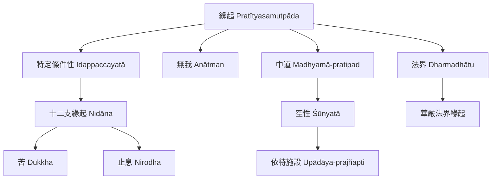

本圖以早期經典的特定條件性作為主線，再連接無我、中道、空性與後期傳統發展。閱讀時應區分「經文公式」、「哲學詮釋」與「現代跨學科應用」。

## 概念連結
* [[緣起 Pratītyasamutpāda]]
* [[特定條件性 Idappaccayatā]]
* [[十二支緣起 Nidāna]]
* [[苦 Dukkha]]
* [[空性 Śūnyatā]]
* [[無我 Anātman]]
* [[中道 Madhyamā-pratipad]]
* [[法界 Dharmadhātu]]

## 參考
* [[早期經典以十二支說明苦的生起與止息]]
* [[緣起描述特定條件關係而非無差別的萬物互聯]]
* [[Pratītyasamutpāda]]
