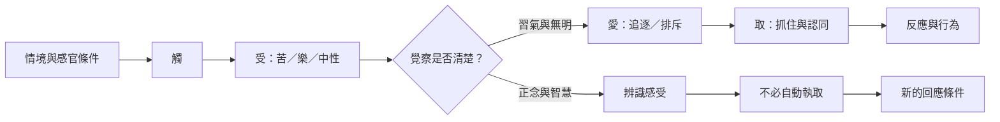

此圖將十二支轉化為可觀察的身心歷程，但不主張所有經驗都能被十二支完整解釋。尤其「觸、受、愛、取」可作為當下觀察的入口，協助辨識感受如何被渴求或抗拒接續。

核心入口：[[觸]]、[[受]]、[[愛]]、[[取]]、[[正念]]、[[五蘊]]。

## 延伸連結
* [[note/觀受與愛之間的條件能提供修行觀察入口|受與愛的觀察]]、[[note/緣起的修行價值在於改變條件而非責怪單一個體|改變條件]]。
* [[idea/以十二支繪製一次日常情緒反應的條件圖|情緒條件圖]]、[[idea/將善友與環境視為修行的共同條件|修行支持網絡]]。

## 原典與研究
* [[data/分別緣起經逐項界定十二支的意義|SN 12.2]]。
* [[data/日本研究從觸與受檢驗輪迴解讀的根據|phassa 與 vedanā 的研究]]。
* [[data/當代跨學科研究把緣起連到主體形成的心理歷程|認知心理學的跨學科嘗試]]。
