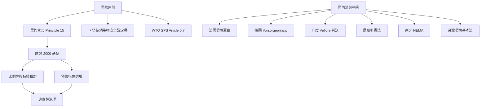

此圖將國際宣言、條約與國內法放在同一張制度地圖中。不同制度對觸發條件、證明責任、暫時性、比例性與複查的規定並不完全相同，不能把它們概括為單一全球標準。

制度比較筆記：[[里約宣言把嚴重或不可逆損害的科學不確定性轉化為及時行動的理由]]、[[歐盟將預警原則具體化為比例性與持續檢討的治理指引]]、[[卡塔赫納生物安全議定書允許在科學資訊不足時保護生物多樣性]]、[[WTO 檢疫協定容許暫時措施但要求取得新資料並在合理期間檢討]]、[[法國環境憲章要求對嚴重且不可逆風險採取暫時且合比例措施]]、[[德國的 Vorsorgeprinzip 將預先照護與污染預防納入環境政策]]、[[印度 Vellore 判決將預警原則與污染者付費納入環境法]]、[[厄瓜多憲法把科學證據不足時的環境保護明確寫入國家義務]]、[[南非環境管理法把知識限制與環境權納入審慎治理原則]]、[[台灣環境基本法要求有重大危害之虞時以環境保護優先]]。
