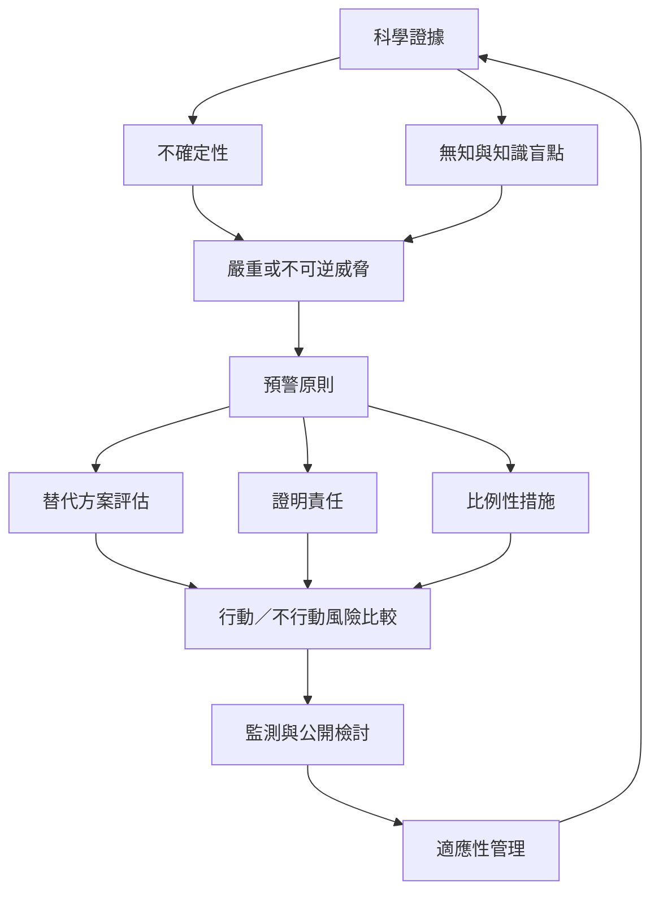

這張地圖整理預警原則如何從知識狀態出發，轉化為行動、證據與學習制度。首先區分[[Uncertainty|不確定性]]與[[Ignorance|無知]]，再判斷威脅是否嚴重且不可逆，之後比較[[Risk|風險]]、替代方案與[[Proportionality|比例性]]，最後透過[[Adaptive_management|適應性管理]]持續監測與修正。

核心閱讀：[[預警原則處理的是不確定性下的嚴重威脅而非所有日常風險]]、[[損害越嚴重且越不可逆越需要提前處理證據門檻]]、[[科學不確定性不等於無知而無知也不等於沒有風險]]、[[預警原則要求評估替代路徑而不是只在禁止與放行之間二選一]]、[[預警措施必須與潛在損害相稱並保留修正空間]]、[[預警政策必須把無知與知識盲點納入持續監測]]。
