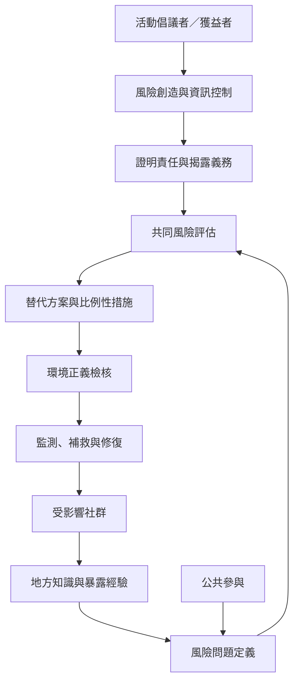

預警決策同時是知識問題與分配問題。誰定義風險、誰掌握證據、誰受益、誰暴露、誰有能力參與，以及誰負責修復，會共同決定原則是否真正保護公共利益。此圖將[[Environmental_justice|環境正義]]、[[Public_participation|公眾參與]]、[[Burden_of_proof|舉證責任]]與地方知識放在同一個互賴結構中。

延伸筆記：[[證明責任應隨風險創造能力與利益分配而重新安排]]、[[受影響社群的地方知識應進入風險評估與預警決策]]、[[預警決策的正當性取決於資訊公開與受影響者的實質參與]]、[[預警決策應把風險分配與環境正義一起評估]]、[[把風險承擔與決策權一起重新分配]]。
