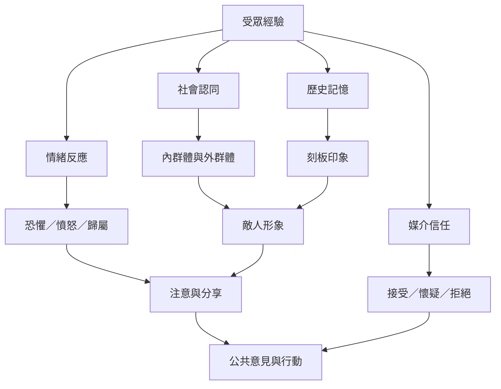

宣傳訊息的效果會受到受眾既有身分、歷史記憶、情緒、社群關係與媒介信任影響。這張圖將受眾視為會解讀、轉化、拒絕與再傳播訊息的行動者，而不是被動容器。

## 概念連結
* [[社會認同]]、[[刻板印象]]、[[敵人形象]]、[[替罪羊]]、[[擬態環境]]、[[公共意見]]。
* 研究筆記：[[宣傳效果取決於社會脈絡而非訊息本身]]、[[可信度是宣傳效果與反效果的關鍵條件]]。

---

本筆記隸屬於 [[Propaganda]] 主題書庫。
