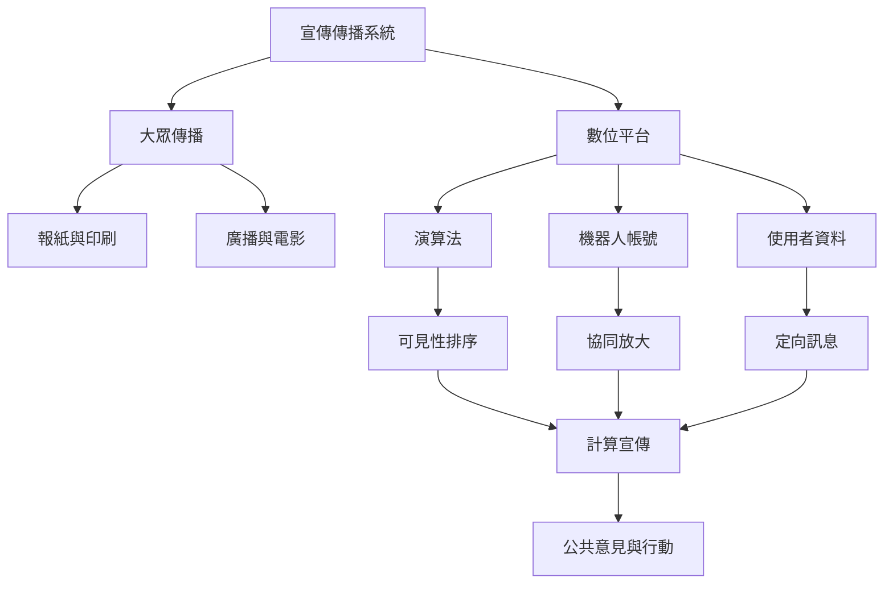

此地圖聚焦從印刷、廣播、電影到社群平台的媒介變遷。技術改變訊息的速度、可複製性、定向程度與可見性，但政治操作者、制度激勵與地方衝突仍是不可缺少的分析單位。

## 概念連結
* [[大眾傳播]]、[[計算宣傳]]、[[機器人帳號]]、[[假草根運動]]、[[迴音室]]、[[過濾氣泡]]。
* 核心分析：[[演算法與人類策展共同決定政治訊息的可見性]]、[[匿名與自動化能製造虛假的社會共識感]]、[[計算宣傳是社會技術組合而非單一工具]]、[[數位宣傳是長期共演化的關係系統]]。

---

本筆記隸屬於 [[Propaganda]] 主題書庫。
