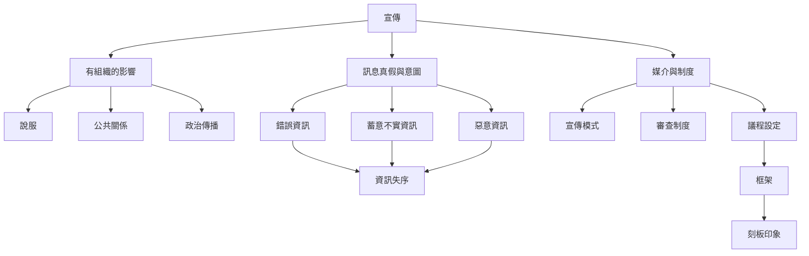

本圖整理宣傳與相鄰概念，重點是先區分內容真假、傳播者意圖、訊息目的與媒體結構，再進一步分析宣傳、說服、公關與資訊失序如何交疊。分析時不應單靠政治立場判斷。

## 概念連結
* [[宣傳]]、[[說服]]、[[公共關係]]、[[政治傳播]]、[[錯誤資訊]]、[[蓄意不實資訊]]、[[惡意資訊]]、[[資訊失序]]、[[審查制度]]、[[議程設定]]、[[框架]]、[[宣傳模式]]。
* 分析筆記：[[宣傳是有組織的影響活動，不等於謊言]]、[[宣傳與說服必須依目的、資訊流與受眾關係區分]]、[[宣傳分析應追蹤整個傳播系統]]。

---

本筆記隸屬於 [[Propaganda]] 主題書庫。
