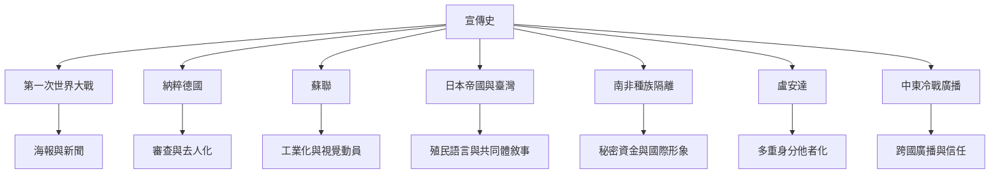

此地圖將宣傳視為跨時代、跨媒介的歷史現象。各案例的制度、受眾與暴力程度不同，並非可以互相等同；比較的目的在辨識媒介、權力與地方脈絡如何共同構成宣傳。

## 概念連結
* [[第一次世界大戰使宣傳成為大規模國家工程]]、[[敵人形象把政治衝突轉譯成道德對立]]、[[殖民宣傳常以共同體承諾包裝權力不平等]]、[[圖像把抽象政策轉譯成可辨識的日常願景]]。
* 案例文獻：[[牛津大學第一次世界大戰史料指南呈現戰時新聞與審查的互動]]、[[美國大屠殺紀念館說明納粹宣傳如何配合審查與暴力政策]]、[[芝加哥大學圖書館的蘇聯海報收藏呈現工業化與政治動員]]、[[日本帝國東亞文化生產透過「共榮」語言包裝殖民不平等]]、[[日治時期的臺灣語宣傳揭示殖民語言政策的工具性]]、[[日治臺灣商業廣告也能承載戰時動員符號]]、[[南非資訊醜聞揭露種族隔離政權以秘密資金操縱國際形象]]、[[盧安達廣播宣傳透過多重歷史身分建構他者]]、[[中東冷戰廣播史呈現跨國資訊戰如何侵蝕信任]]。

---

本筆記隸屬於 [[Propaganda]] 主題書庫。
