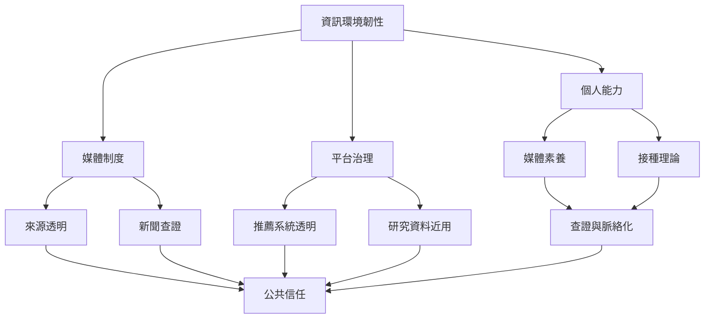

反宣傳的目標不應只是用另一套訊息取代對方，而是修復公眾判斷條件：來源透明、查證可行、受害者被聽見、平台可受監督、不同群體能在不被羞辱的情況下討論。媒體素養和制度改革需要互補。

## 概念連結
* [[媒體素養]]、[[接種理論]]、[[透明度是說服與操縱的重要倫理分界]]、[[媒體素養應教會人們檢查訊息如何生成與流通]]、[[事前揭露操縱手法能提升受眾抵抗力]]、[[把反宣傳做成公開可查證的集體照護，而非對立動員]]。

---

本筆記隸屬於 [[Propaganda]] 主題書庫。
