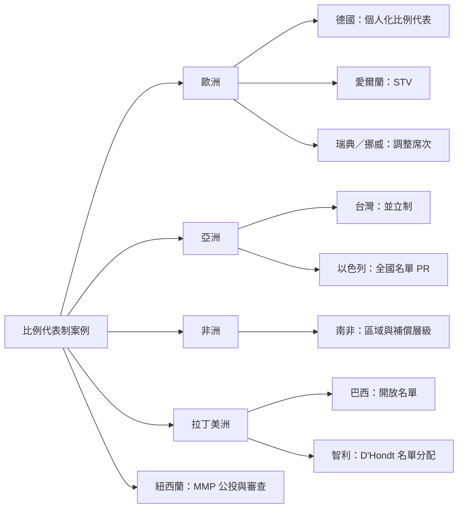

本圖把案例放在制度類型與改革背景之中。不同國家即使採用類似的比例代表原則，仍會因歷史、社會分歧、政黨結構與選區設計而產生不同政治結果。

**概念與案例：** [[紐西蘭聯立制以政黨票決定國會總席次]]、[[愛爾蘭單記可讓渡投票讓選民排序候選人]]、[[德國2025年聯邦選舉以第二票決定政黨席次總額]]、[[瑞典以調整席次修正選區結果的比例失衡]]、[[挪威以平衡席次修正選區結果並設全國門檻]]、[[以色列以全國名單比例代表制分配國會席次]]、[[台灣立委選舉是區域席次與不分區名單並立]]、[[南非2024年國會選制加入獨立候選人並保留補償席次]]、[[巴西女性保障名額未必能轉化為當選比例]]、[[智利以漢狄法在多席次選區分配名單席次]]、[[紐西蘭公投與獨立審查顯示選制改革可以持續修正]]

**主題導讀：** [[Proportional_representation|《比例代表制：選票如何轉化為多元而可問責的政治代表》]]。
